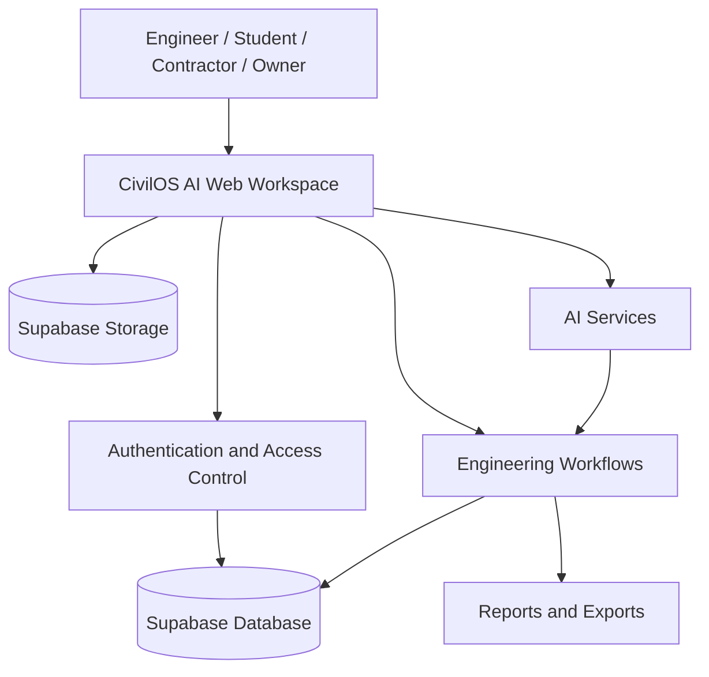

<!-- CivilOS AI repository overview. Add only authentic product screenshots to public/readme/. -->

# 🏗️ CivilOS AI

### AI CIVIL ENGINEERING OS

**From drawing to estimate — smarter construction decisions.**

An engineering workspace bringing civil-engineering workflows, project context, AI assistance and construction documentation together.

---

## 🧭 Explore CivilOS AI

| Workspace | Purpose |
|---|---|
| 🤖 AI Engineering Assistant | Engineering questions, construction guidance and project-aware assistance |
| 📐 Drawing & Design | Floor-plan workflows, drawing review and design exploration |
| 📊 Quantity & Estimation | Quantity takeoff, material calculations and cost planning |
| 📋 BOQ & BBS | Bills of Quantities and reinforcement scheduling workflows |
| 🧮 Engineering Calculations | Practical calculators and unit conversions |
| 🏗️ Project Workspace | Organize project information, documents and engineering work |
| 🗺️ Site & Survey | Site-oriented and location-aware engineering workflows |
| 📄 Reports & Exports | Structured engineering documentation and output workflows |

> **Feature availability:** CivilOS AI is actively developed. The live application is the source of truth for currently available features; some capabilities may be evolving or marked as coming soon.

---

## 🖼️ Product preview

Real interface screenshots are not fabricated. Add current, permission-safe captures to the repository before displaying them here.

*Illustrative workflow concept — this graphic is not a screenshot of the live application.*

| Screenshot | Recommended asset |
|---|---|
| Main dashboard | public/readme/dashboard.png |
| Project workspace | public/readme/project-workspace.png |
| 2D floor-plan editor | public/readme/floor-plan-editor.png |
| 3D building view | public/readme/3d-building-view.png |
| BOQ / quantity workspace | public/readme/boq-workspace.png |
| AI assistant | public/readme/ai-assistant.png |

After adding a real screenshot, embed it with a relative Markdown image link, for example:

    

---

## 🧩 Platform architecture

The following is a high-level product map, not a complete deployment or security specification.

---

## 🧱 Engineering workflow areas

### 📐 Drawings and design
- Floor-plan and drawing workflows
- Drawing upload and interpretation workflows
- Room, dimension and building information
- 2D and 3D design experiences as available in the application

### 📊 Quantity, BOQ and estimation
- Construction quantity takeoff
- Material and labor estimation
- BOQ preparation
- Project cost planning
- Assumptions, units and calculation review

### 🔩 Reinforcement and calculations
- Bar Bending Schedule (BBS) workflows
- Steel, concrete, masonry and finishing calculations
- Unit conversion and quantity helpers

### 🗂️ Project delivery
- Project-based organization
- Engineering documents and reports
- Site-oriented workflows
- Export and review workflows

**Engineering note:** AI-assisted or automatically generated quantities are decision-support outputs. Verify drawings, assumptions, local rates, codes and structural decisions with qualified professionals before construction or procurement.

---

## 🛠️ Technology

| Area | Technology |
|---|---|
| UI | React 18, TypeScript |
| Build tooling | Vite |
| Backend client | Supabase JS |
| Data fetching | TanStack Query |
| 3D foundation | Three.js, React Three Fiber, Drei |
| UI primitives | Radix UI, Tailwind CSS |
| Charts | Recharts |
| Forms and validation | React Hook Form, Zod |
| Testing | Vitest, Testing Library |
| Progressive web app | Vite PWA plugin |

The exact production configuration is defined by the source code, environment and deployment settings.

---

## 🚀 Run locally

**Requirements:** Node.js compatible with the repository toolchain, npm and Git.

### 1. Clone

    git clone https://github.com/zobaerio/CivilOS-AI.git
    cd CivilOS-AI

### 2. Install

    npm install

### 3. Configure environment

Create a local environment file using the variable names required by the current source code and deployment configuration.

- Never commit .env or .env.local.
- Never expose service-role keys or private API credentials in browser code.
- Use only development credentials that you are authorized to access.

### 4. Start the development server

    npm run dev

### 5. Run project checks

    npm run lint
    npm test
    npm run build

If a script or environment dependency is unavailable in your local setup, inspect package.json and the project configuration before changing commands.

---

## 🗺️ Development principles

- **Engineering-first:** prioritize traceable calculations, units and assumptions.
- **Project isolation:** keep each project's information scoped to the correct project.
- **Honest AI:** distinguish detected information, user input, assumptions and missing data.
- **Secure by design:** enforce authorization on the server and database, not only in the UI.
- **Responsive workflows:** support mobile, tablet and desktop layouts.
- **No fake functionality:** identify unfinished capabilities instead of presenting placeholders as working features.

---

## 🤝 Contributing

1. Create a feature branch from the current default branch.
2. Keep each change focused and consistent with existing patterns.
3. Include or update tests where appropriate.
4. Run lint, tests and production build.
5. Document behavior changes and required environment variables.
6. Open a pull request with a clear summary and verification notes.

For bug reports, include reproduction steps, expected and actual behavior, browser/device details and screenshots when useful. Do not publish secrets or private user data in an issue.

---

## 🔐 Security

If you discover a security vulnerability, do not disclose exploit details or sensitive information in a public issue. Contact the maintainer through a private channel.

Never commit credentials, access tokens, private keys or production user data.

---

## 👨‍💻 Maintainer

**MD ZOBAER HASAN**  
Civil Engineering Student · Developer · Founder of Zobaerio

- 🌐 [Portfolio](https://zobaerio.vercel.app/)
- 💻 [GitHub](https://github.com/zobaerio)
- 🔵 [Facebook](https://facebook.com/zobaerio)
- 💼 [LinkedIn](https://linkedin.com/in/zobaerio)
- ▶️ [YouTube](https://www.youtube.com/@zobaerio)

**CivilOS AI — AI CIVIL ENGINEERING OS**

[Open the application](https://civilosai.pro.bd) · [View source code](https://github.com/zobaerio/CivilOS-AI)

